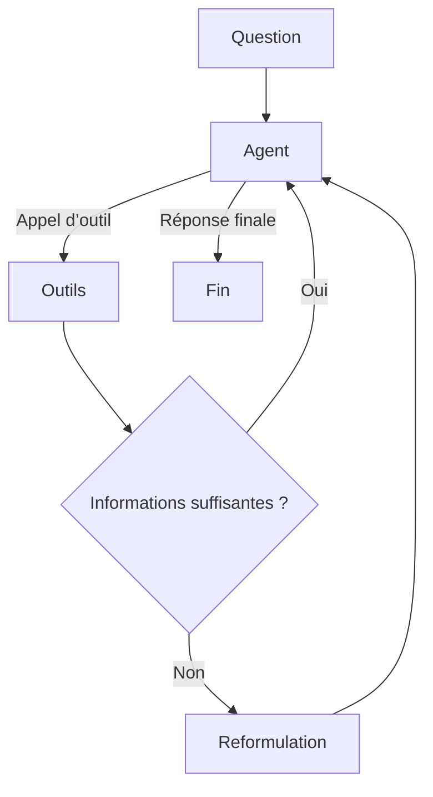

# Agentic RAG

Prototype d’agent de recherche augmenté par récupération (Agentic RAG), construit avec **LangGraph**, **LangChain**, **Ollama** et **Tavily**. L’agent peut interroger une source locale de démonstration, rechercher des informations sur le Web et extraire le texte de pages pertinentes avant de rédiger une réponse.

> **État du projet :** prototype pédagogique. La recherche locale est actuellement simulée et ne s’appuie pas encore sur une base documentaire ni sur un moteur de recherche vectorielle.

## Fonctionnement

Le graphe orchestre les étapes suivantes :

1. L’agent analyse la question et choisit les outils nécessaires.
2. Pour une recherche d’informations récentes, il lance une recherche Web avec Tavily.
3. Il peut extraire le contenu des pages trouvées avec `scrape_url` afin de répondre à partir du texte, et non des seuls titres ou liens.
4. Après les outils, un évaluateur estime si les informations recueillies suffisent. Si nécessaire, la question est reformulée et une nouvelle recherche est effectuée.
5. L’agent produit la réponse finale.

Le nombre d’appels aux outils est limité à **5** et le nombre de reformulations à **2**.



## Prérequis

- Python 3.10 ou une version ultérieure
- [Ollama](https://ollama.com/) installé et démarré
- Une clé API Tavily

Le modèle local configuré dans `app/model.py` est `qwen2.5:3b`.

## Installation

Depuis le dossier `agentic-rag` :

### Windows (PowerShell)

```powershell
py -m venv .venv
.\.venv\Scripts\Activate.ps1
python -m pip install -r requirements.txt
```

### macOS / Linux

```bash
python3 -m venv .venv
source .venv/bin/activate
python -m pip install -r requirements.txt
```

Téléchargez ensuite le modèle utilisé par l’application :

```bash
ollama pull qwen2.5:3b
```

Créez un fichier `.env` à la racine de `agentic-rag` et ajoutez-y votre clé :

```dotenv
TAVILY_API_KEY=votre_cle_tavily
```

Le fichier `.env` est ignoré par Git. Ne publiez pas votre clé API et ne la placez pas directement dans le code.

## Lancement

Depuis le dossier `agentic-rag`, avec l’environnement virtuel activé et Ollama en cours d’exécution :

```bash
python -m app.main
```

Le module exécute une question d’exemple définie dans `app/main.py`, affiche la réponse finale, puis les appels aux outils effectués. Il ne propose pas encore d’interface interactive.

## Structure du projet

```text
agentic-rag/
├── app/
│   ├── main.py       # Graphe LangGraph et orchestration de l’agent
│   ├── model.py      # Configuration du modèle Ollama
│   ├── tools.py      # Recherche locale, recherche Web et extraction de pages
│   └── state.py      # Modèles de données pour les résultats et les sources
├── requirements.txt
└── README.md
```

## Outils disponibles

- **`search_local_knowledge`** — retourne actuellement un résultat de démonstration codé en dur ; aucune ingestion de documents n’est configurée.
- **`web_search`** — interroge Tavily pour obtenir des résultats Web.
- **`scrape_url`** — récupère une page HTTP(S), retire les éléments non textuels courants et renvoie au maximum 3 000 caractères.

## Limites actuelles

- La base de connaissances locale doit être remplacée par une véritable source documentaire et un mécanisme de recherche.
- La sélection d’outils et la qualité des réponses dépendent du modèle configuré.
- L’extraction des pages est volontairement simple et peut ne pas fonctionner sur certains sites.
- Le modèle est défini directement dans `app/model.py` ; il n’est pas configurable par variable d’environnement.
